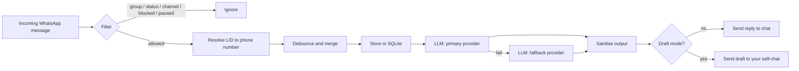

# WhatsApp AI Auto-Reply Bot

A lightweight AI auto-reply bot for **your own personal WhatsApp number**, built on [Baileys](https://github.com/WhiskeySockets/Baileys) (Node.js). It replies inside your existing chats, in your voice, using free-tier LLM APIs (Groq / Gemini) with automatic failover. Runs happily on a Raspberry Pi.

> **Disclaimer:** This project uses an **unofficial** WhatsApp Web protocol library. It is **not affiliated with, endorsed by, or supported by WhatsApp or Meta**. Using it violates WhatsApp's Terms of Service and **can get your number banned**. Use at your own risk, preferably on a secondary number first. See [Risks & Limitations](#risks--limitations).

---

## Table of Contents

- [Features](#features)
- [How it works](#how-it-works)
- [Requirements](#requirements)
- [Quick start](#quick-start)
- [Configuration](#configuration)
- [Chat commands](#chat-commands)
- [LLM providers](#llm-providers)
- [Per-contact personas](#per-contact-personas)
- [Draft mode](#draft-mode)
- [Run 24/7 (systemd, Raspberry Pi)](#run-247-systemd-raspberry-pi)
- [Project structure](#project-structure)
- [Troubleshooting](#troubleshooting)
- [Security & privacy](#security--privacy)
- [Risks & limitations](#risks--limitations)
- [Contributing](#contributing)
- [License](#license)

---

## Features

| Area | What you get |
|---|---|
| **Personal number** | Works as a linked device (like WhatsApp Web). No separate business number needed |
| **Fast replies** | LLM call and the "human" delay run in parallel, so latency is `max(delay, LLM)` rather than their sum. Typically 1-3 s on Groq |
| **Provider failover** | Groq and Gemini via OpenAI-compatible endpoints. If the primary fails (quota, timeout, bad output), the next one is tried |
| **Allowlist / all-contacts mode** | Reply only to chosen numbers, or to everyone except a blocklist |
| **Number-based matching** | You configure plain phone numbers. WhatsApp's `@lid` identifiers are resolved to numbers automatically |
| **Smart pause** | If *you* type in a chat, the bot goes silent there for a configurable time, so you and the bot never talk over each other |
| **Debounce** | Several messages sent in quick succession are merged into a single reply |
| **Rate limiting** | Per-chat cooldown and hourly cap to reduce ban risk and API usage |
| **Persistent memory** | Conversation history stored in SQLite (`chat.db`), so context survives restarts |
| **Per-contact prompts** | Give each contact its own persona / system prompt |
| **Draft mode** | Bot sends nothing; it drops a suggested reply in your "Message yourself" chat for you to edit and send |
| **Voice notes** | Transcribed with Groq Whisper and answered as text (requires a Groq key) |
| **Output sanitising** | Strips leaked reasoning blocks (`<thought>`) and stray HTML/XML tags that some models emit |
| **Safe by design** | Groups, status updates and channels are ignored. The bot has no tool or shell access, text replies only |
| **Self-chat control** | Toggle everything with `/bot ...` commands from your own chat |
| **Resilient** | Exponential-backoff reconnect, clean exit on logout |

## How it works



1. The bot logs in as a **linked device** by scanning a QR code once. Credentials are saved in `./auth`.
2. Each incoming 1:1 text message (or voice note) is checked against your allow/block rules and pause state.
3. Messages are debounced, stored, and the last N turns are sent to the LLM along with the system prompt.
4. The reply is cleaned, sent after a short human-like delay, and saved to history.
5. Messages you send from your own phone pause the bot in that chat and are added to the history, so the model has context when it resumes.

## Requirements

- **Node.js 22.5+** (uses the built-in `node:sqlite` module). Check with `node -v`
- A WhatsApp account you are willing to risk (see [disclaimer](#risks--limitations))
- At least one free API key:
  - [Groq](https://console.groq.com) (recommended: fast, also provides Whisper for voice notes)
  - [Google AI Studio](https://aistudio.google.com/apikey) (Gemini)
- A machine that stays online: laptop, VPS, or Raspberry Pi (64-bit OS recommended)

## Quick start

```bash
git clone https://github.com/<your-username>/<your-repo>.git
cd <your-repo>

npm install
cp .env.example .env
chmod 600 .env
# edit .env and add your key(s)
```

Edit the `CFG` block at the top of `bot.js` and put the numbers you want the bot to answer in `ALLOW` (digits only, with country code, no `+`):

```js
ALLOW: new Set(["919876543210", "14155550123"]),
```

Run it:

```bash
node --disable-warning=ExperimentalWarning --env-file=.env bot.js
```

On the first run a QR code appears in the terminal. On your phone open **WhatsApp > Settings > Linked devices > Link a device** and scan it. The session is stored in `./auth`, so you will not be asked again.

Test from a **different** phone/number. Messages you send from your own account are never answered by the bot.

If you do not have a `package.json` yet:

```bash
npm init -y
npm pkg set type=module
npm pkg set engines.node=">=22.5"
npm pkg set scripts.start="node --disable-warning=ExperimentalWarning --env-file=.env bot.js"
npm i @whiskeysockets/baileys qrcode-terminal openai pino
```

Then simply `npm start`.

## Configuration

### Environment variables (`.env`)

| Variable | Required | Description |
|---|---|---|
| `GROQ_API_KEY` | one of the two | Groq API key (`gsk_...`). Also enables voice-note transcription |
| `GEMINI_API_KEY` | one of the two | Google AI Studio key (`AIza...`) |
| `PROVIDER` | no | Primary provider: `groq` (default) or `gemini`. The other is used as fallback if its key is set |
| `GROQ_MODEL` | no | Default `llama-3.3-70b-versatile`. Use `llama-3.1-8b-instant` for lowest latency |
| `GEMINI_MODEL` | no | Default `gemini-flash-lite-latest` |

Free-tier limits and model IDs change often. Verify them in each provider's console.

### Bot settings (`CFG` in `bot.js`)

| Setting | Default | Description |
|---|---|---|
| `MODE_ALL` | `false` | `true` = reply to every 1:1 chat except `BLOCK`. `false` = only `ALLOW` |
| `ALLOW` | `[]` | Numbers the bot may answer (digits only) |
| `BLOCK` | `[]` | Numbers the bot never answers (checked first) |
| `DRAFT_ALL` | `false` | Never send replies, only drafts to your self-chat |
| `DRAFT_ONLY` | `[]` | Numbers that get drafts only; everyone else gets normal replies |
| `DEBOUNCE_MS` | `1200` | Wait this long for follow-up messages before replying. Raise to ~2500 to merge slower bursts, at the cost of latency |
| `DELAY_MIN` / `DELAY_MAX` | `700` / `1300` | Minimum human-like delay (ms), overlapped with the LLM call |
| `COOLDOWN_MS` | `3000` | Minimum gap between replies in the same chat. Messages are queued, not dropped |
| `MAX_PER_HOUR` | `30` | Max bot replies per chat per hour |
| `PAUSE_HOURS` | `2` | How long the bot stays quiet in a chat after you type there yourself |
| `HISTORY_TURNS` | `10` | Number of recent messages sent to the LLM |
| `TEMPERATURE` | `0.8` | Sampling temperature |
| `TIMEOUT_MS` | `5000` | Per-provider request timeout |
| `VOICE` | `true` | Transcribe voice notes (needs `GROQ_API_KEY`) |
| `FALLBACK` | `"baad mein batata hu"` | Sent if every provider fails. Set to `null` to stay silent instead |

Restart the bot after editing `CFG`. Some options can be toggled live with [chat commands](#chat-commands).

## Chat commands

Send these in your **own** "Message yourself" chat. They are ignored in every other chat so they can never leak to a contact.

| Command | Effect |
|---|---|
| `/bot on` / `/bot off` | Enable / disable the bot globally |
| `/bot draft on` / `/bot draft off` | Switch draft-only mode |
| `/bot all on` / `/bot all off` | Reply to everyone vs. allowlist only |
| `/bot status` | Show current state, active pauses and provider order |

## LLM providers

Both providers are used through their **OpenAI-compatible** endpoints, so adding another (OpenRouter, Mistral, a local Ollama server, ...) means adding one entry to the `PROVIDERS` object:

```js
ollama: {
  key: "ollama",                                  // any non-empty string
  baseURL: "http://localhost:11434/v1",
  model: "llama3.1:8b",
  maxTokens: 150,
},
```

Provider order is `PROVIDER` first, then the rest that have a key. On timeout, HTTP error or empty output the next one is tried.

**Notes**

- Some Gemini "flash-lite" variants occasionally leak reasoning or markup tags into replies. The sanitiser handles most of it, but Groq/Llama models are cleaner for chat.
- Reasoning-style models can burn the whole `max_tokens` budget on hidden thinking and return nothing. If you see `FAIL` in the logs, raise `maxTokens` for that provider.

## Per-contact personas

Edit the `PROMPTS` object in `bot.js`. The key is the contact's number:

```js
const PROMPTS = {
  "919876543210": `You are <name>, chatting casually with a close friend.
Short messages, Hinglish, dry humour. Never invent facts about my life.${RULES}`,
};
```

Anyone without an entry uses the default `SYSTEM` prompt. Always append `${RULES}`; it contains the injection guards and the "don't lie if sincerely asked whether you're an AI" rule. Remove or change it only if you understand the trade-offs.

## Draft mode

With `DRAFT_ALL: true` (or `/bot draft on`), nothing is sent to contacts. For every incoming message the bot posts this in your self-chat:

```
✉️ 919876543210: what's up, free tonight?

💡 haan free hu, bol kya plan hai
```

You review, edit, and send it yourself. This is the recommended way to start, and the safest way to use the bot for anything personal or important.

## Run 24/7 (systemd, Raspberry Pi)

Authenticate once by running `node bot.js` manually and scanning the QR, then install the service:

```bash
mkdir -p ~/.config/systemd/user
cat > ~/.config/systemd/user/wa-bot.service <<'EOF'
[Unit]
Description=WhatsApp AI bot
After=network-online.target

[Service]
WorkingDirectory=%h/wa-bot
EnvironmentFile=%h/wa-bot/.env
ExecStart=/usr/bin/node --disable-warning=ExperimentalWarning bot.js
Restart=on-failure
RestartSec=10

[Install]
WantedBy=default.target
EOF

systemctl --user daemon-reload
systemctl --user enable --now wa-bot
loginctl enable-linger $USER      # keep running after logout
journalctl --user -u wa-bot -f    # live logs
```

**Raspberry Pi tips**

- Use a 64-bit Raspberry Pi OS and install Node 22+ (e.g. via NodeSource or `nvm`). The distro default is often too old
- Do **not** run a local LLM on the Pi; use Groq/Gemini and the bot barely touches the CPU
- Prefer Ethernet over Wi-Fi and a decent SD card or SSD (`./auth` is written to often)
- Never run the same `./auth` session on two machines at once; they will kick each other off
- Back up `./auth` occasionally

## Project structure

```
.
├── bot.js            # entire bot (config, providers, filters, WhatsApp handlers)
├── package.json
├── .env.example      # template for secrets
├── .gitignore
├── README.md
├── auth/             # WhatsApp session (generated, never commit)
└── chat.db           # SQLite history (generated, never commit)
```

## Troubleshooting

| Symptom | Likely cause / fix |
|---|---|
| No QR shown | Terminal too small. Enlarge the window or reduce font size |
| `No such built-in module: node:sqlite` | Node is older than 22.5. Upgrade |
| `ExperimentalWarning: SQLite...` | Harmless. Silence with `--disable-warning=ExperimentalWarning` |
| Bot connects but never replies | Sender's number not in `ALLOW` (and `MODE_ALL` is `false`), or you are testing from your own account |
| `skip (number unresolved)` in logs | LID could not be mapped to a number. Upgrade with `npm i @whiskeysockets/baileys@latest` |
| Only the fallback text is sent | All providers failed. Check the `[groq]` / `[gemini]` error lines: invalid key (401/403), wrong model ID (404), rate limit (429), or timeout |
| `</thought>`, `</p>` or other tags in replies | Model leak. Make sure the sanitiser is active, or switch to Groq/Llama |
| Replies are slow | Use `llama-3.1-8b-instant`, lower `HISTORY_TURNS`, keep `maxTokens` small. Check the `LLM+delay ...ms` log line |
| Bot and you both reply in a chat | The bot pauses for `PAUSE_HOURS` after you type. If it does not, check that your own messages reach the log with `fromMe` |
| "Logged out" and exit | The session was revoked on the phone. Delete `./auth` and scan again |
| Phone stops getting notifications | The bot sets `markOnlineOnConnect: false` to avoid this. Keep it that way |

## Security & privacy

- **Never commit** `.env`, `auth/` or `chat.db`. Anyone with `auth/` can read and send as you. The provided `.gitignore` already excludes them
- If a key ever appears in a screenshot, log, or commit, **revoke and regenerate it** immediately; removing it from git history is not enough
- Message contents are sent to third-party LLM providers. Free tiers may log prompts or use them for training. Read the provider's terms before routing other people's private chats through them, or point the bot at a local model (Ollama)
- The bot only produces text. It has no shell, file or network tools, which limits the damage of prompt injection. Keep it that way
- Consider telling the people you chat with that an assistant may reply on your behalf; some jurisdictions and many relationships expect that honesty

## Risks & limitations

- **Ban risk is real.** Unofficial clients can be flagged, especially with high volume or robotic patterns. Keep the delay, cooldown and hourly cap, start with few contacts, and prefer a secondary number
- The protocol can change at any time and break the library until it is updated upstream
- Linked devices are logged out if your phone is offline for ~14 days
- Text and voice notes only; images, stickers, reactions and documents are ignored
- Groups, broadcasts, status updates and channels are intentionally skipped
- This is **not** a replacement for the official [WhatsApp Business Platform](https://developers.facebook.com/docs/whatsapp), which is the only supported route for business or multi-user bots (it cannot operate inside your personal chats)
- Provider free tiers, limits and model names change frequently

## Contributing

Issues and pull requests are welcome. Good first improvements: more providers, image understanding, a hot-reloadable config file, per-chat enable/disable commands, tests for the filtering logic.

## License

MIT. See `LICENSE`. Baileys and other dependencies are under their own licenses.

---

*Built for personal automation and learning. You are responsible for how you use it.*
